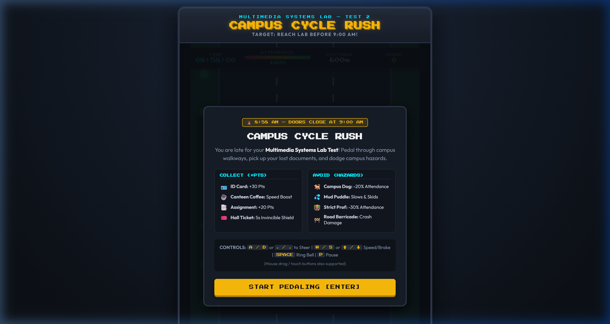
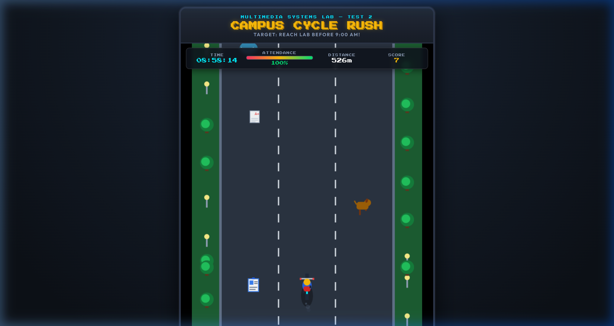
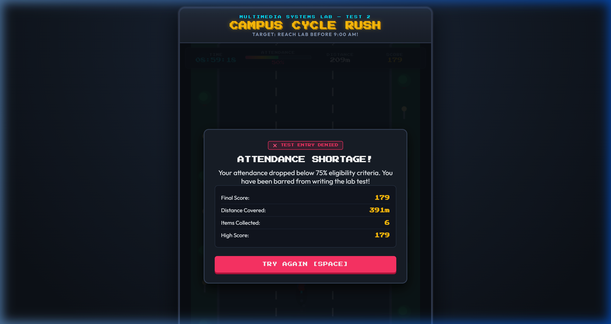

# Multimedia Systems Lab — Lab Test 2
## Project: Campus Cycle Rush: 8:59 AM (Customizable 2D Arcade Game)

---

### 1. Student & Project Details
* **Course:** Multimedia Systems Lab
* **Test:** Lab Test 2 — Interactive 2D Arcade Game
* **Title:** Campus Cycle Rush: 8:59 AM
* **Tech Stack:** HTML5 Canvas, Vanilla JavaScript (ES6+), Web Audio API, Vanilla CSS3
* **Execution Environment:** Any modern web browser (Google Chrome, Microsoft Edge, Mozilla Firefox) — zero external libraries or installations required.

---

### 2. Problem Statement & Objective
Design and develop an interactive 2D arcade game demonstrating:
1. **Multimedia Integration:** Visual sprites, dynamic particle animations, screen effects, and synthesized audio sound effects.
2. **Animation & Physics:** Continuous 60 FPS updates, scrolling environmental parallax, steering tilt physics, and pedaling cycles.
3. **User Interaction & Event Handling:** Keyboard navigation, mouse/touch dragging, and on-screen arcade buttons.
4. **Collision Detection & State Management:** Robust Axis-Aligned Bounding Box (AABB) hit testing across multiple active game entities.
5. **Individual Customization:** A unique campus life storyline, Attendance % life gauge, and special power-up mechanics.

---

### 3. Game Story & Concept
You are an undergraduate student rushing on a bicycle from the campus hostel to **Lab 204** to take your **Multimedia Systems Lab Test**. 
The lab doors lock strictly at **09:00:00 AM**. You have 600 meters of busy campus walkways to navigate while avoiding stray dogs, lawn puddles, and strict professors who deduct your attendance!

---

### 4. Game Rules & Objectives

#### Objective:
Cover the **600-meter** distance to Lab 204 before the clock strikes **09:00:00 AM**, while keeping your **Attendance above 60%**.

#### Collectibles:
| Item | Sprite | Effect | Points |
| :--- | :---: | :--- | :--- |
| **College ID Card** | 🪪 | Essential credential pickup | **+30 Pts** |
| **Assignment Sheet** | 📑 | Completed lab report pages | **+20 Pts** |
| **Canteen Coffee** | ☕ | Speed boost (+35% velocity for 3s) | **+25 Pts** |
| **Hall Ticket (Special)** | 🎟️ | **5-Second Invincible Shield** (destroys obstacles) | **+50 Pts** |

#### Hazards & Penalties:
| Hazard | Sprite | Penalty / Effect |
| :--- | :---: | :--- |
| **Campus Stray Dog** | 🐕 | Runs across walkway; causes collision (**-20% Attendance**) |
| **Mud Puddle / Sprinkler** | 💦 | Water skid & speed reduction (**-10% Attendance**) |
| **Strict Professor** | 👨‍🏫 | Inspects student (**-30% Attendance**) |

---

### 5. Controls

* **Steering:** `A / D` or `Left / Right Arrow` (or click & drag mouse on canvas / tap on-screen buttons)
* **Accelerate / Brake:** `W / S` or `Up / Down Arrow`
* **Bicycle Bell:** `SPACEBAR` (Rings pleasant *ding-ding!* bell and scares nearby campus dogs onto the sidewalks)
* **Pause / Resume:** `P` key (or Pause button)
* **Start / Restart:** `ENTER` or `SPACEBAR`

---

### 6. Screenshots of Gameplay & Game States

#### Start Screen


#### Active Gameplay Screen


#### Game Over (Attendance Shortage Screen)


---

### 7. Technical Architecture & Algorithms

#### A. Core Game Loop (60 FPS)
The game uses `window.requestAnimationFrame()` to maintain a fixed-time update and render loop:
```
[User Input] ➔ [Update Physics & Positions] ➔ [Check AABB Collisions] ➔ [Render Canvas & Particles] ➔ [Sync HUD]
```

#### B. Collision Detection Algorithm (Axis-Aligned Bounding Box — AABB)
To detect collisions between the cyclist and rectangular/circular entities, the standard **AABB Theorem** with an internal padding tolerance is used:

$$\text{Overlap}_X = (x_1 + \text{pad} < x_2 + w_2 - \text{pad}) \land (x_1 + w_1 - \text{pad} > x_2 + \text{pad})$$
$$\text{Overlap}_Y = (y_1 + \text{pad} < y_2 + h_2 - \text{pad}) \land (y_1 + h_1 - \text{pad} > y_2 + \text{pad})$$
$$\text{Collision} = \text{Overlap}_X \land \text{Overlap}_Y$$

```javascript
function checkAABBCollision(rect1, rect2, padding = 6) {
  return (
    rect1.x + padding < rect2.x + rect2.width - padding &&
    rect1.x + rect1.width - padding > rect2.x + padding &&
    rect1.y + padding < rect2.y + rect2.height - padding &&
    rect1.y + rect1.height - padding > rect2.y + padding
  );
}
```

#### C. Difficulty Progression Algorithm
As the player moves closer to the lab gate (distance decreases from 600m to 0m), the game increases difficulty through:
1. **Dynamic Scroll Velocity:** Increases linearly from `4.5 px/frame` to `8.5 px/frame` via `SPEED_ACCELERATION`.
2. **Hazard Frequency:** Obstacles spawn in tighter intervals as velocity ramps up.
3. **Simulated Exam Clock:** The clock dynamically interpolates between 08:58:00 AM and 09:00:00 AM based on distance covered.

---

### 8. Multimedia Systems Integration Details

1. **Native Web Audio API Sound Synthesizer (`SoundController` in `game.js`):**
   * **Bicycle Bell:** Dual-sine wave oscillators at 1760 Hz and 2093 Hz with exponential volume decay.
   * **Coin/Collect Chime:** Rising triangle wave from 587 Hz (D5) to 880 Hz (A5).
   * **Crash Sound:** Sawtooth oscillator dropping rapidly from 160 Hz to 40 Hz.
   * **Background Chiptune Groove:** 8-note retro bass arpeggiator (136 BPM) generated using square-wave oscillators.
   * *Advantage:* Zero external `.mp3` dependencies; guaranteed to run on any lab examiner machine without broken audio paths.
2. **Procedural 2D Canvas Graphics:**
   * Hand-coded vector sprites for the cyclist (pedaling legs, helmet, bike frame, spinning wheels).
   * Dynamic particle emitters for tire dust, water ripples, gold sparkle stars, and shield energy rings.
   * Screen-shake effect rendered via canvas matrix translation on collision.

---

### 9. Assigned Individual Customizations Demonstrated

1. **Unique Visual Theme:** College Campus Morning Rush (asphalt walkways, grass lawns, streetlamps, trees, students, faculty).
2. **Custom Health Mechanic ("Attendance %"):**
   * Starts at 100%. Collisions with hazards deduct attendance.
   * Game Over triggers if attendance falls below the university minimum criteria of **60%**.
3. **Interactive Bicycle Bell Mechanic:**
   * Pressing `Spacebar` rings the bell, emitting acoustic particles and scaring campus dogs away from your lane.
4. **Golden Hall Ticket Shield Power-Up:**
   * Grants 5 seconds of invincibility with a 3-node orbital energy ring. Touching hazards while shielded destroys them and awards bonus score.
5. **Canteen Coffee Boost:**
   * Gives a 35% speed burst with steam bubble particle animations.

---

### 10. Examiner / Viva Quick-Modification Guide
All key gameplay numbers are declared at the **very top of `game.js` (lines 10–35)** inside the `CONFIG` object:

| Parameter | Location | Default | Viva Test Instructions |
| :--- | :--- | :--- | :--- |
| `CONFIG.PLAYER_SPEED` | Line 12 | `7.0` | Change to `12.0` to make cyclist move super fast. |
| `CONFIG.INITIAL_ATTENDANCE` | Line 13 | `100` | Change starting attendance percentage. |
| `CONFIG.MIN_ATTENDANCE_TO_PASS` | Line 14 | `60` | Change passing criteria. |
| `CONFIG.TOTAL_DISTANCE_METERS`| Line 21 | `600` | Set to `100` to quickly demonstrate the **Victory Screen**. |
| `CONFIG.SHIELD_DURATION_FRAMES`| Line 29 | `300` | Set to `600` (10 seconds) to extend shield duration. |

---

### 11. How to Execute
1. **Option A (Direct Browser Launch):**
   * Simply double-click `index.html` in Windows Explorer to open it in Google Chrome, Microsoft Edge, or Firefox.
2. **Option B (Local Web Server):**
   * Open PowerShell in this folder and run:
     ```powershell
     python -m http.server 8000
     ```
   * Open `http://localhost:8000` in your web browser.
